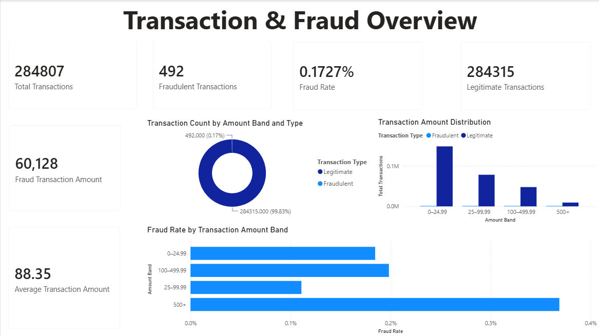
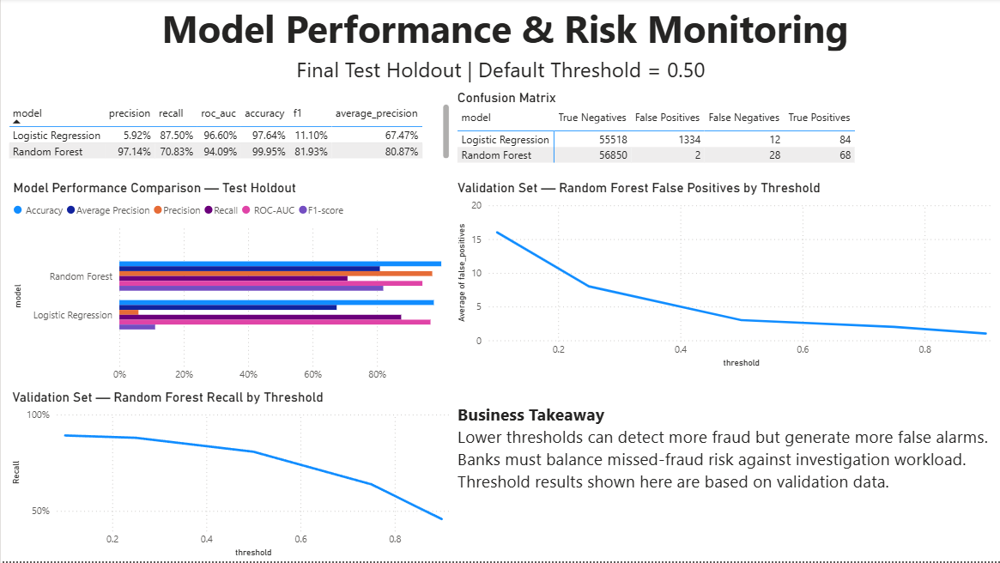

# Credit Card Fraud Detection & Transaction Risk Analytics

An end-to-end portfolio project demonstrating transaction data validation, exploratory analysis, leakage-aware fraud classification, model evaluation, SQL risk queries, and a Power BI dashboard implementation package. It is designed for Data Analyst and BI Analyst roles, with reproducibility and business interpretation prioritized over model complexity.

**Technologies:** Python, Pandas, scikit-learn, Matplotlib, Seaborn, Jupyter, SQL, DAX, and Power BI Desktop.

## Business problem and success criteria

Identify potentially fraudulent transactions while explaining the trade-off between missed fraud and legitimate transactions flagged for review. Success means reproducible analysis, a stratified holdout, precision/recall and Average Precision reporting, transparent threshold comparisons, and business interpretation. Accuracy is not the primary objective.

## Dataset and findings

Source: [Kaggle Credit Card Fraud Detection](https://www.kaggle.com/datasets/mlg-ulb/creditcardfraud). `data/creditcard.csv` came from the user-provided archive and is excluded from Git. It has 284,807 rows, 31 columns, 492 frauds (0.172749%), 1,081 duplicate rows, and no missing values. Amount is right-skewed. The dataset records transactions from two days in September 2013; Time is elapsed seconds rather than a calendar timestamp. V1–V28 are anonymized PCA components. This old dataset does not establish present-day or production performance.

| Field | Meaning |
|---|---|
| Time | Seconds elapsed from dataset start |
| V1–V28 | Anonymized PCA features |
| Amount | Transaction amount in source context |
| Class | Actual label: 0 legitimate, 1 fraud |

To download: visit the [Kaggle dataset page](https://www.kaggle.com/datasets/mlg-ulb/creditcardfraud), download `creditcard.csv` (a Kaggle account may be required), and place it at `data/creditcard.csv`. The raw file is excluded from Git and must never be committed or uploaded. The source currency is not specified.

The corrected workflow was run on this dataset. It uses a fixed-seed stratified split of unique predictor groups, so identical feature vectors stay together. The final holdout has 56,948 transactions and 96 frauds (0.168575% prevalence). At the fixed baseline threshold of 0.5:

| Model | Accuracy | Precision | Recall | F1 | Average Precision | ROC-AUC | TP | FP | FN | TN |
|---|---:|---:|---:|---:|---:|---:|---:|---:|---:|---:|
| Logistic Regression | 0.976364 | 0.059238 | 0.875000 | 0.110964 | 0.674710 | 0.966023 | 84 | 1,334 | 12 | 55,518 |
| Random Forest | 0.999473 | 0.971429 | 0.708333 | 0.819277 | 0.808699 | 0.940928 | 68 | 2 | 28 | 56,850 |

These corrected results describe this split and setup, not production performance. Logistic Regression detected 84 of 96 frauds but flagged 1,334 legitimate transactions. Random Forest flagged 2 legitimate transactions but missed 28 frauds. Accuracy is high because fraud is rare.

Confusion matrices use actual class as rows and predicted class as columns (0 = legitimate, 1 = fraud):

| Model | TN | FP | FN | TP | Matrix |
|---|---:|---:|---:|---:|---|
| Logistic Regression | 55,518 | 1,334 | 12 | 84 | `[[55,518, 1,334], [12, 84]]` |
| Random Forest | 56,850 | 2 | 28 | 68 | `[[56,850, 2], [28, 68]]` |

At the validation threshold comparison, lowering Random Forest's threshold from 0.50 to 0.10 raised recall from 80.7% to 89.2%, while false positives rose from 3 to 16 on the validation subset. Thresholds were not selected using the final test set. The validation counts illustrate investigation trade-offs; they are not forecasts of operating workload.

### Duplicate audit and sensitivity

There are 1,081 duplicate rows beyond first copies, across 773 repeated predictor groups (1,854 rows in those groups). No repeated feature group has conflicting target labels. Under the former row-random split, 293 repeated groups (806 rows total) crossed between train and test. The corrected split has zero crossing groups. Duplicates remain in the source because they may be valid repeated observations; the corrected evaluation groups them instead of silently deleting rows.

| Model | Former row-random AP | Corrected grouped AP | Former recall | Corrected recall | Former FP | Corrected FP |
|---|---:|---:|---:|---:|---:|---:|
| Logistic Regression | 0.715912 | 0.674710 | 0.918367 | 0.875000 | 1,386 | 1,334 |
| Random Forest | 0.859748 | 0.808699 | 0.734694 | 0.708333 | 3 | 2 |

Average Precision and recall decreased for both models in this sensitivity comparison, but the split and test composition also changed (the grouped holdout contains 96 rather than 98 frauds). The result is consistent with a possible optimistic effect, but does not isolate duplicate leakage as the sole cause. The prior metrics are retained only as a sensitivity baseline; corrected grouped results are the primary results.

Threshold comparisons are calculated on an inner stratified group validation subset of training data (45,613 transactions; 83 frauds). No threshold is selected because review capacity and relative business costs were not supplied. Final test metrics use the fixed 0.5 baseline threshold, once, on the untouched grouped holdout. On validation, lowering the Random Forest threshold from 0.50 to 0.10 raised recall from 80.7% to 89.2% and increased false positives from 3 to 16. These are validation counts, not workload forecasts.

### Evaluation methodology

The split hash is computed from predictor columns only. A stratified split is performed over unique feature groups, keeping repeated vectors together. Groups with conflicting target labels are rejected before splitting; this dataset has none. A second group split within training data provides validation predictions for threshold comparisons. The baseline threshold remains 0.5, with no test-driven threshold selection. Models are refit on the full development partition then evaluated once on the untouched grouped test set. No resampling, cross-validation tuning, or test-set model selection is performed. Logistic Regression scaling remains inside its Pipeline and is fitted on training rows only; Random Forest receives raw columns. Scored CSV probabilities, labels, and actual targets align to the same transaction indices. Confusion counts reconcile to the test population.
## Project structure

```text
credit-card-fraud-detection/
├── data/                 # local raw CSV; excluded from Git
├── notebooks/            # five guided analysis and evaluation notebooks
├── src/                  # validation, preprocessing, training, evaluation
├── tests/                # data validation tests
├── sql/                  # portable transaction risk queries
├── outputs/              # small aggregate evaluation CSVs; scored rows excluded
└── dashboard/            # DAX, data dictionary, guide, QA checklist, previews
```

## Setup and run

1. Install Python 3.10+ and create a virtual environment.
2. Install dependencies: `python -m pip install -r requirements.txt`.
3. If missing, download `creditcard.csv` from the Kaggle source (account may be required) to `data/creditcard.csv`. Never commit/upload raw data.
4. Run tests: `python -m pytest` (verified: 5 passed).
5. Train and export: `python -m src.train`. Optional model persistence: `python -m src.train --save-models`.
6. Open notebooks in order using Jupyter. All five notebooks were executed successfully in the audited environment; see `outputs/notebook_execution_status.txt`. The reusable modules compile with `python -m compileall -q src tests`.

## Generated files

`scored_transactions.csv` has one holdout row per model/transaction, actual label, predicted label and fraud probability, without PCA features or Amount. `model_comparison.csv` reports metrics; `threshold_analysis.csv` compares thresholds on validation data; `confusion_matrices.csv`, `split_audit.csv`, and `sensitivity_comparison.csv` provide reconciled confusion counts and duplicate-aware split evidence; `fraud_summary.csv` summarizes actual class counts and amounts. Small aggregate outputs are suitable for Git; row-level scores and serialized models remain gitignored.

## SQL and Power BI portfolio layer

`sql/fraud_analysis.sql` uses portable ANSI-style SQL examples and specifies input tables; queries have not been run against a database. The Power BI package is documented in `dashboard/`:

- Page 1, **Transaction & Fraud Overview**, uses the full `data/creditcard.csv` population and actual `Class` labels.
- Page 2, **Model Performance & Risk Monitoring**, uses final holdout predictions and metrics; threshold comparisons remain on the training-side validation subset.
- `dashboard/data_dictionary.md` defines source tables and their grain, `dashboard/dax_measures.dax` contains measures and derived display fields, and `dashboard/powerbi_build_guide.md` gives the Desktop build sequence. `dashboard/dashboard_qa_checklist.md` provides reconciliation checks.

Import `creditcard.csv`, `scored_transactions.csv`, `model_comparison.csv`, `confusion_matrices.csv`, and `threshold_analysis.csv` as described in the guide. Save the manually created report to `dashboard/credit_card_fraud_risk_analytics.pbix`. The `.pbix` is not present in this workspace and must be created and verified in Power BI Desktop. Keep actual source labels distinct from model predictions, and keep validation thresholds separate from final test metrics.

Two dashboard page preview images are present. They are image files only; they do not verify a saved or working `.pbix` report:

### Transaction & Fraud Overview preview



### Model Performance & Risk Monitoring preview



The screenshot filenames have been standardized to use a single `.png` extension.

## Reproducibility and public repository notes

The training workflow uses fixed random seeds, a duplicate-aware stratified holdout, a training-side validation subset for threshold comparisons, and pipelines that fit preprocessing on training data only. The small aggregate files under `outputs/` come from the verified run and are intended for the public repository; `scored_transactions.csv` is excluded because it is row-level generated output. Re-running `python -m src.train` regenerates the CSV outputs. Python dependency minimums are listed in `requirements.txt`; exact environment versions are not locked.

A public Git repository has not yet been initialized in this workspace. Before the first commit, review the staged file list and confirm `data/creditcard.csv`, `outputs/scored_transactions.csv`, credentials, and local environment files are absent.

## Limitations and ethics

Anonymized features limit explanations; only 492 fraud cases are available; temporal drift and missing customer/merchant context limit generalization. False flags can inconvenience customers and missed fraud can cause loss. Any consequential use requires human review and operational validation. This educational project is not a production-ready banking system. Future work could add training-only cross-validation, temporal validation with timestamps, calibration, review-capacity analysis with stakeholder cost inputs, and drift monitoring.
